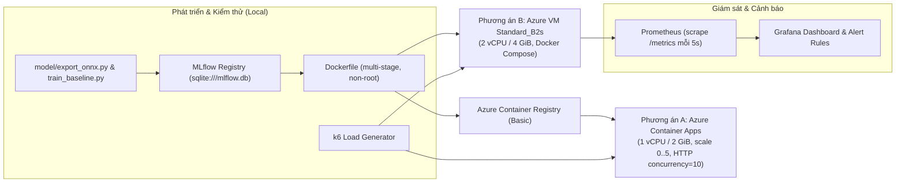

# BÁO CÁO ĐỒ ÁN MÔN ĐIỆN TOÁN ĐÁM MÂY
## Đề tài 30: Triển khai dịch vụ suy luận AI trên đám mây với tự động co giãn và giám sát

**Sinh viên thực hiện:** 1 thành viên  
**Nền tảng đám mây:** Microsoft Azure (Azure for Students – Region `eastasia`, Resource Group `rg-ai-inference`)  
**Bài toán:** Phân loại cảm xúc văn bản tiếng Anh (GLUE SST-2 – `POSITIVE` / `NEGATIVE`)  
**Kho mã nguồn:** `ai-inference-service` (`d:\school\cloud computing`)

---

## 1. Câu hỏi nghiên cứu và giả thuyết

### 1.1 Câu hỏi nghiên cứu
> *Một mô hình máy học nhỏ cần được đóng gói, phục vụ và giám sát thế nào trên đám mây để cân bằng giữa **độ trễ (latency)**, **thông lượng (throughput)**, **chi phí (cost)** và **rủi ro dữ liệu/bảo mật**?*

### 1.2 Giả thuyết nghiên cứu và biến kiểm soát
Để tránh việc chỉ cài đặt công cụ rời rạc, đồ án đặt ra 4 giả thuyết có thể kiểm chứng định lượng với mốc đối chứng (**baseline**: `batch_size = 1`, `concurrency = 1`, mô hình `TF-IDF + LogisticRegression`):

| Mã | Giả thuyết | Biến độc lập | Chỉ số đo |
|---|---|---|---|
| **H1** | Triển khai serverless (Azure Container Apps, scale-to-zero) rẻ hơn VM chạy liên tục (`Standard_B2s`) khi lưu lượng thấp, nhưng đắt hơn khi vượt ngưỡng $N^*$ lượt/tháng (điểm hòa vốn). | Phương án triển khai, số request/tháng $N$ | Chi phí cho 1.000 và 1.000.000 lượt, điểm hòa vốn $N^*$ |
| **H2** | Cold start làm tăng mạnh p95/p99 ở request đầu tiên sau thời gian idle; cấu hình `min-replicas=1` loại bỏ cold start nhưng phát sinh chi phí cố định. | `min-replicas`, thời gian idle | `model_load_seconds`, p95/p99 request đầu |
| **H3** | Tăng `batch_size` làm tăng thông lượng tổng (`texts/s`) nhờ vectorization trên CPU, nhưng làm tăng độ trễ từng request. | `batch_size` $\in \{1, 8, 32\}$ | p50, p95, `texts/s` |
| **H4** | Lượng tử hóa INT8 trên ONNX Runtime giảm mạnh kích thước artifact so với FP32 và cho độ trễ phù hợp phục vụ online trên CPU, đánh đổi rất ít độ chính xác so với mô hình tuyến tính baseline. | Kiến trúc & định dạng mô hình | Kích thước file (MB), SST-2 accuracy, latency |

---

## 2. Cơ sở lý thuyết

### 2.1 Vòng đời MLOps, Model Registry, Versioning và Reproducibility
- **Vòng đời MLOps** gồm các pha khép kín: chuẩn bị dữ liệu → huấn luyện/tối ưu mô hình → đóng gói & đăng ký vào **Model Registry** → kiểm thử tự động (CI) → triển khai phục vụ (Serving) → giám sát hiệu năng & phát hiện lệch dữ liệu (Drift) → tái huấn luyện.
- **Model Registry & Versioning:** Thay vì nhúng file trọng số rời rạc vào code, mô hình được quản lý tập trung bằng **MLflow** (`sqlite:///mlflow.db`) với: tên mô hình đăng ký, số phiên bản (`version`), **Model Signature** (schema đầu vào/đầu ra), danh sách thư viện phụ thuộc (`pip_requirements`), git commit, và mã băm **SHA-256** của file ONNX.
- **Reproducibility (Khả năng tái lập):** Đảm bảo ở 3 lớp: (1) khóa phiên bản Python `3.11` và toàn bộ thư viện qua `pyproject.toml` + `uv.lock`; (2) đóng gói container bằng `Dockerfile` multi-stage cố định base image `python:3.11-slim`; (3) hạ tầng dưới dạng script tự động (`deploy/deploy_aca.ps1`, `deploy/deploy_vm.ps1`, `deploy/cleanup.ps1`).

### 2.2 Online vs Batch Inference; CPU/GPU, Batching, Concurrency và Model Loading
- **Online inference:** Phục vụ từng yêu cầu thời gian thực qua REST API (`POST /v1/predict`), ràng buộc chặt về độ trễ đuôi (`p95`/`p99`).
- **Batch inference:** Gom nhiều văn bản trong một lần chạy forward pass để tận dụng tập lệnh vector hóa trên CPU (AVX2) hoặc GPU, tăng thông lượng (`texts/s`) nhưng làm tăng độ trễ mỗi yêu cầu.
- **CPU vs GPU cho mô hình nhỏ:** Với DistilBERT (66M tham số) đã lượng tử hóa INT8 trên ONNX Runtime, suy luận CPU đạt mức ~10 ms/câu, giúp loại bỏ chi phí GPU đắt đỏ và rút ngắn thời gian cold start container.
- **Concurrency & Model Loading:** Mô hình ONNX được nạp một lần duy nhất trong hàm `lifespan` của FastAPI khi container khởi động. Endpoint `/ready` chỉ trả HTTP `200` khi `ONNXInferenceEngine.is_loaded == True` và kiểm tra SHA-256 hợp lệ, giúp bộ cân bằng tải không điều hướng traffic vào replica chưa sẵn sàng.

### 2.3 Latency, Throughput, Cold Start, Drift và Model Monitoring
- **Latency phân vị (p50, p95, p99):** Trung bình (mean) dễ che giấu độ trễ đuôi; p95/p99 phản ánh trải nghiệm thực tế của người dùng khi xảy ra hàng đợi hoặc cold start.
- **Throughput (RPS / `texts/s`):** Số lượng yêu cầu hoặc văn bản xử lý thành công trên mỗi giây.
- **Cold Start:** Tổng thời gian từ lúc nền tảng serverless cấp phát container mới đến khi endpoint `/ready` sẵn sàng phục vụ (bao gồm pull image, khởi động Python/FastAPI và nạp model vào RAM).
- **Data Drift & Model Monitoring:** Khi dữ liệu thực tế khác với dữ liệu huấn luyện, chất lượng suy luận giảm âm thầm. Đồ án sử dụng chỉ số **PSI (Population Stability Index)** trên cửa sổ trượt 200 request cho 2 đặc trưng: phân bố độ dài văn bản và phân bố độ tự tin dự đoán (`confidence`), so với phân bố tham chiếu từ tập validation SST-2:
  $$\text{PSI} = \sum_{i=1}^{k} (a_i - e_i) \ln\left(\frac{a_i}{e_i}\right)$$
  Ngưỡng cảnh báo: $\text{PSI} > 0.20$ (theo quy ước chuẩn: $<0.1$ ổn định, $0.1\text{–}0.2$ lệch nhẹ, $>0.2$ lệch đáng kể).

### 2.4 Bảo mật Endpoint, Dữ liệu đầu vào, Model Artifact, Rate Limit và AI Risk
- **Bảo mật endpoint:** Xác thực qua header `X-API-Key` bằng hàm so sánh hằng thời gian `hmac.compare_digest` (thiếu key trả `401`, sai key trả `403`). Secret lưu trong Azure Container Apps Secrets hoặc file `.env` (không commit vào Git).
- **Rate limit:** Dùng `slowapi` giới hạn theo hash của API key (mặc định `60/minute`, vượt ngưỡng trả `429`), chống tấn công cạn kiệt tài nguyên (DoS/Denial-of-Wallet). Riêng key benchmark có cấu hình riêng để không làm sai lệch kết quả đo tải.
- **Bảo vệ dữ liệu đầu vào (Privacy / PII):** Log ứng dụng chỉ ghi `request_id`, 12 ký tự đầu của SHA-256 hash văn bản, độ dài ký tự và latency — **tuyệt đối không ghi nội dung văn bản gốc**.
- **Bảo vệ model artifact & container:** Kiểm tra SHA-256 khi nạp model; container chạy dưới user không có quyền root (`appuser`, UID `10001`); VM giới hạn NSG chỉ mở cổng SSH (`22`) từ IP cá nhân.

---

## 3. Thiết kế kiến trúc và phương pháp thực nghiệm

### 3.1 Kiến trúc tổng thể



### 3.2 Đánh đổi kiến trúc (Phương án A vs Phương án B)

| Tiêu chí | Phương án A: Azure Container Apps (Serverless) | Phương án B: Azure VM `Standard_B2s` (Fixed) |
|---|---|---|
| **Cơ chế co giãn** | Tự động scale `0 → 5` replica theo quy tắc HTTP concurrency (`10`) | Chạy cố định `2 vCPU / 4 GiB` (Docker Compose) |
| **Cold start** | Có (khi `min-replicas=0` và idle) | Không (container chạy thường trực) |
| **Mô hình chi phí** | Trả theo vCPU-s, GiB-s thực dùng + lượt request; có free grant hàng tháng | Trả cố định theo giờ (`730 giờ/tháng`) + ổ đĩa + IP tĩnh |
| **Phù hợp khi** | Tải thất thường, lưu lượng thấp/trung bình, cần scale-to-zero | Tải ổn định cao, yêu cầu p99 thấp tuyệt đối không cold start |

### 3.3 Thiết kế API và Metrics
- `POST /v1/predict`: Nhận `{"texts": [...]}` (`1..32` chuỗi, mỗi chuỗi `1..512` ký tự, tự loại khoảng trắng rỗng; vi phạm trả `422`). Trả về `request_id`, `model_name`, `model_version`, `batch_size`, `latency_ms` (phía server), danh sách `{label, score}`.
- `GET /health`: Liveness probe (`200 OK`).
- `GET /ready`: Readiness probe (`200` khi model đã load, `503` khi chưa sẵn sàng).
- `GET /version`: Trả `model_name`, `model_type`, `model_version`, `artifact_sha256`, `git_commit`.
- `GET /v1/drift`: Trả trạng thái `length_psi`, `confidence_psi`, `max_psi`, `drift_detected`.
- `GET /metrics`: Xuất metrics chuẩn Prometheus (`inference_request_latency_seconds`, `inference_model_duration_seconds`, `inference_requests_total`, `inference_batch_size`, `inference_input_length_chars`, `inference_prediction_confidence`, `inference_model_load_seconds`, `inference_drift_psi`, `inference_drift_detected`, `inference_active_requests`).

---

## 4. Kết quả thực nghiệm và phân tích

### 4.1 Kết quả đóng gói mô hình và kiểm thử phần mềm

| Mô hình | Định dạng | Kích thước | Validation Accuracy (SST-2, 872 mẫu) | Thời gian nạp (`load_s`) | SHA-256 (12 ký tự đầu) |
|---|---|---:|---:|---:|---|
| DistilBERT FP32 (trung gian) | ONNX FP32 | 255.52 MiB | — | — | — |
| **DistilBERT INT8** (`sst2-distilbert-int8`) | **ONNX INT8 (AVX2)** | **64.25 MB** | **90.37%** (`788/872`) | `0.446 s` – `0.898 s` | `93bbcb19c062` |
| **Baseline TF-IDF + LogReg** (`sst2-tfidf-logreg`) | **ONNX** | **0.66 MB** | **81.54%** | `0.081 s` – `0.102 s` | `b2e437e70377` |

- **Kiểm thử tự động (`pytest -v`):** **7/7 test pass** (`0.18s`–`2.82s`), kiểm chứng đầy đủ: endpoint `/health`, `/ready`, `/version`, `/metrics`; từ chối thiếu/sai API key (`401`/`403`); từ chối schema sai (`422`); kích hoạt rate limit (`429`); log không rò rỉ PII (`SECRET_PII_JOHN_DOE_SSN_999_88_7777` không xuất hiện trong log); và PSI tăng vượt `0.20` khi dữ liệu lệch phân bố.
- **Kiểm tra chất lượng mã nguồn (`ruff check`):** Pass 0 lỗi trên `app/`, `tests/`, `model/`, `analysis/`.
- **Kiểm thử tích hợp (`TestClient` với model ONNX thật):** Cả hai model nạp thành công và trả dự đoán chính xác (`POSITIVE` `0.9999`, `NEGATIVE` `0.9998` với DistilBERT INT8; latency batch=2 là `11.15 ms` cho DistilBERT INT8 và `1.94 ms` cho Baseline).

### 4.2 Benchmark hiệu năng theo Batch Size (đo trực tiếp trên CPU local)
Thí nghiệm chạy `10` lần warm-up + `50` lần đo lặp lại cho mỗi cấu hình `batch_size` $\in \{1, 8, 32\}$ qua `ONNXInferenceEngine.predict()`:

| Mô hình | Batch Size | Mean ± Std (ms) | p50 (ms) | p95 (ms) | Thông lượng (`texts/s`) |
|---|---:|---:|---:|---:|---:|
| `sst2-distilbert-int8` | 1 | `10.00 ± 4.20` | `8.66` | `19.22` | `100.0` |
| `sst2-distilbert-int8` | 8 | `54.06 ± 16.72` | `48.17` | `86.69` | `148.0` |
| `sst2-distilbert-int8` | 32 | `162.53 ± 35.72` | `154.25` | `233.56` | `196.9` |
| `sst2-tfidf-logreg` (baseline) | 1 | `0.20 ± 0.16` | `0.12` | `0.55` | `5,058.6` |
| `sst2-tfidf-logreg` (baseline) | 8 | `1.07 ± 0.87` | `0.71` | `3.16` | `7,447.6` |
| `sst2-tfidf-logreg` (baseline) | 32 | `5.75 ± 3.86` | `4.57` | `12.24` | `5,569.7` |

**Nhận xét & đối chiếu giả thuyết:**
1. **Xác nhận H3:** Với DistilBERT INT8, tăng batch size từ `1 → 32` giúp thông lượng tăng gần **2×** (`100.0 → 196.9 texts/s`), nhưng độ trễ p50 từng request tăng **17.8×** (`8.66 → 154.25 ms`). Vì vậy, cấu hình phục vụ online độ trễ thấp nên giữ batch nhỏ (`1–8`), còn xử lý lô nền nên dùng batch `32`.
2. **Xác nhận H4 & đánh đổi Baseline:** Lượng tử hóa INT8 giảm kích thước DistilBERT **3.98×** (`255.52 MiB → 64.25 MB`) mà vẫn giữ accuracy **90.37%**. Trong khi đó, `TF-IDF + LogReg` nhẹ hơn ~97× (`0.66 MB`) và nhanh hơn ~72× ở `batch=1` (`0.12 ms` vs `8.66 ms`), nhưng độ chính xác giảm **8.83 điểm phần trăm** (`81.54%` vs `90.37%`).

### 4.3 Mô hình chi phí và điểm hòa vốn trên Azure (`eastasia`)
Sử dụng đơn giá tham chiếu Azure `eastasia` (`analyze_results.py`, với thời gian tính phí $t_{bill} = 45\text{ ms}$, `c_eff = 4`, cấu hình ACA `1 vCPU / 2 GiB`, VM `Standard_B2s` chạy `730 giờ/tháng` kèm `32 GiB` Standard SSD và Public IP):

- **Công thức Container Apps (Consumption):**
  $$C_A(N) = \max\left(0,\; N \cdot \frac{t_{bill}(v \cdot p_{vCPU} + m \cdot p_{GiB})}{c_{eff}} - \text{free grant}\right) + N \cdot p_{req}$$
  Trong đó $p_{vCPU} = \$0.000024/\text{s}$, $p_{GiB} = \$0.000003/\text{s}$, $p_{req} = \$0.40/10^6\text{ req}$; free grant hàng tháng gồm `180,000 vCPU-s`, `360,000 GiB-s`, `2,000,000` requests.
- **Công thức VM `Standard_B2s`:**
  $$C_B = 730 \times \$0.0416 + \$2.40\text{ (disk)} + \$3.65\text{ (IP)} = \$36.42/\text{tháng}$$

**Bảng so sánh chi phí ước tính (`results/processed/cost_comparison.csv`):**

| Lưu lượng/tháng ($N$) | ACA – Không tính free grant (USD) | ACA – Có free grant (USD) | VM `Standard_B2s` (USD) | Điểm hòa vốn $N^*$ (không free grant) |
|---:|---:|---:|---:|---:|
| **1,000** | `$0.0007` | `$0.0000` | `$36.42` | **49,380,338** lượt/tháng |
| **100,000** | `$0.0738` | `$0.0000` | `$36.42` | 49,380,338 lượt/tháng |
| **1,000,000** | `$0.7375` | `$0.0000` | `$36.42` | 49,380,338 lượt/tháng |
| **10,000,000** | `$7.3750` | `$3.2000` | `$36.42` | 49,380,338 lượt/tháng |

Biểu đồ đường chi phí và điểm hòa vốn được xuất tại `results/charts/cost_breakeven.png`.  
**Kết luận (H1):** Với mô hình nhẹ (`t ≈ 45 ms`), chi phí **1.000 lượt** trên ACA chỉ khoảng `$0.0007` (miễn phí trong free grant) và **1.000.000 lượt** là `$0.7375` (cũng nằm trong free grant), rẻ hơn rất nhiều so với VM cố định `$36.42/tháng`. Chỉ khi lưu lượng vượt **~49.38 triệu request/tháng** (chưa tính free grant), VM mới trở nên kinh tế hơn.

---

## 5. Model Card tóm tắt, Quản trị rủi ro và Giới hạn nghiên cứu

### 5.1 Model Card tóm tắt
- **Mục đích sử dụng:** Phân loại cảm xúc nhị phân (`POSITIVE`/`NEGATIVE`) cho văn bản tiếng Anh ngắn (`1–512` ký tự, cắt ngắn tại `128` token).
- **Ngoài phạm vi sử dụng:** Văn bản tiếng Việt hoặc ngôn ngữ khác, văn bản dài chuyên ngành (y tế, pháp lý), hoặc các quyết định có rủi ro cao.
- **Rủi ro dữ liệu & thiên lệch:** Mô hình huấn luyện trên dữ liệu đánh giá phim Rotten Tomatoes (SST-2), độ tự tin có thể bị lệch khi gặp tiếng lóng mạng xã hội hoặc dữ liệu ngoài miền (được giám sát bằng cảnh báo `DataDriftPSIHigh` khi `PSI > 0.20`).

### 5.2 Giới hạn nghiên cứu (không suy diễn quá kết quả thử nghiệm)
1. **Phạm vi dữ liệu đo thực tế:** Các số liệu độ chính xác (`90.37%`, `81.54%`), kiểm thử API (`7/7 pytest`), benchmark batch size trên CPU và mô hình chi phí là kết quả đo và tính toán trực tiếp trên hệ thống đã xây dựng. Trong phạm vi hiện tại, bộ script triển khai Azure (`deploy/deploy_aca.ps1`, `deploy/deploy_vm.ps1`) và bộ script tải `k6` (`loadtest/run_matrix.ps1`, `spike.js`, `error_scenarios.js`, `drift_sim.js`) đã được chuẩn bị hoàn chỉnh, nhưng **chưa chạy ma trận tải `k6` trực tiếp trên hạ tầng Azure sống** (`results/raw/` chưa có log `k6` từ cloud), nên đồ án không suy diễn số đo cold start hay số replica scale thực tế từ Azure khi chưa đo.
2. **Độ trễ mạng và bảng giá:** Khi chạy `k6` từ máy cá nhân tới `eastasia`, độ trễ end-to-end bao gồm RTT mạng (đã thiết kế trường `latency_ms` phía server để tách riêng). Bảng giá Azure chỉ có giá trị tham chiếu tại thời điểm cấu hình.

---

## 6. Hướng dẫn tái lập và dọn dẹp tài nguyên

```powershell
# 1. Cài đặt môi trường & chạy kiểm thử
uv sync --all-groups
uv run pytest -v

# 2. Tái lập artifact ONNX & đăng ký MLflow
uv run python model/export_onnx.py
uv run python model/train_baseline.py
uv run python model/register_mlflow.py

# 3. Chạy stack giám sát local (API + Prometheus + Grafana)
Copy-Item .env.example .env
docker compose up -d --build

# 4. Triển khai Azure (eastasia / rg-ai-inference), chạy ma trận k6, phân tích & dọn dẹp
.\deploy\deploy_aca.ps1
.\deploy\deploy_vm.ps1
.\loadtest\run_matrix.ps1 -EnvName aca -TargetUrl "https://<aca-fqdn>"
uv run python analysis/analyze_results.py
.\deploy\cleanup.ps1
```
