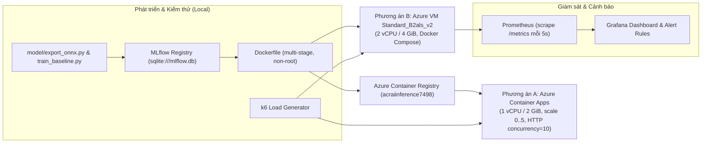

# BÁO CÁO ĐỒ ÁN MÔN ĐIỆN TOÁN ĐÁM MÂY

**TRƯỜNG ĐẠI HỌC GIAO THÔNG VẬN TẢI TP. HỒ CHÍ MINH (UTH)**  
**ĐỀ TÀI 30:** *Triển khai dịch vụ suy luận AI trên đám mây với tự động co giãn và giám sát*  
**Nền tảng triển khai:** Microsoft Azure (Azure for Students – Region `eastasia`, Resource Group `rg-ai-inference`)  
**Hình thức:** 1 thành viên · **Ngày hoàn thành:** 19/11/2026  

---

## 1. Câu hỏi nghiên cứu và giả thuyết

### 1.1 Câu hỏi nghiên cứu
> *Một mô hình máy học nhỏ cần được đóng gói, phục vụ và giám sát thế nào trên đám mây để cân bằng giữa **độ trễ (latency)**, **thông lượng (throughput)**, **chi phí (cost)** và **rủi ro dữ liệu/bảo mật**?*

### 1.2 Giả thuyết nghiên cứu và biến kiểm soát
Mốc đối chứng (**baseline**): `batch_size = 1`, `concurrency (VUs) = 1`, mô hình `TF-IDF + LogisticRegression`.

| Mã | Giả thuyết | Biến độc lập | Chỉ số đo |
|---|---|---|---|
| **H1** | Triển khai serverless (Azure Container Apps, scale-to-zero) rẻ hơn VM chạy liên tục khi lưu lượng thấp, nhưng đắt hơn khi vượt ngưỡng $N^*$ lượt/tháng (điểm hòa vốn). | Phương án triển khai, số request/tháng $N$ | Chi phí cho 1.000 và 1.000.000 lượt, điểm hòa vốn $N^*$ |
| **H2** | Cold start làm tăng mạnh p95/p99 ở request đầu tiên sau thời gian idle; cấu hình `min-replicas=1` loại bỏ cold start nhưng phát sinh chi phí cố định. | `min-replicas`, thời gian idle | `model_load_seconds`, p95/p99 request đầu |
| **H3** | Tăng `batch_size` làm tăng thông lượng tổng (`texts/s`) nhưng làm tăng độ trễ từng request. | `batch_size` $\in \{1, 8, 32\}$ | p50, p95, RPS, `texts/s` |
| **H4** | Lượng tử hóa INT8 trên ONNX Runtime giảm mạnh kích thước artifact so với FP32 và đạt độ trễ phù hợp phục vụ online trên CPU, đánh đổi rất ít độ chính xác so với mô hình tuyến tính baseline. | Kiến trúc & định dạng mô hình | Kích thước file (MB), SST-2 accuracy, latency |

---

## 2. Cơ sở lý thuyết

### 2.1 Vòng đời MLOps, Model Registry, Versioning và Reproducibility
- **Vòng đời MLOps** gồm các pha khép kín: chuẩn bị dữ liệu → huấn luyện/tối ưu mô hình → đóng gói & đăng ký vào **Model Registry** → kiểm thử tự động (CI) → triển khai phục vụ (Serving) → giám sát hiệu năng & phát hiện lệch dữ liệu (Drift) → tái huấn luyện.
- **Model Registry & Versioning:** Mô hình được đăng ký vào **MLflow** (`sqlite:///mlflow.db`) với tên đăng ký (`sst2-distilbert-int8`, `sst2-tfidf-logreg`), số phiên bản (`version = 1`), **Model Signature**, `pip_requirements`, git commit và mã băm **SHA-256** của file ONNX.
- **Reproducibility (Khả năng tái lập):** Đảm bảo qua 3 lớp: (1) khóa phiên bản Python `3.11` và thư viện bằng `pyproject.toml` + `uv.lock`; (2) đóng gói container bằng `Dockerfile` multi-stage cố định base image `python:3.11-slim`; (3) hạ tầng dưới dạng script tự động (`deploy/deploy_aca.ps1`, `deploy/deploy_vm.ps1`, `deploy/cleanup.ps1`).

### 2.2 Online vs Batch Inference; CPU/GPU, Batching, Concurrency và Model Loading
- **Online inference:** Phục vụ từng yêu cầu thời gian thực qua REST API (`POST /v1/predict`), ràng buộc chặt về độ trễ đuôi (`p95`/`p99`).
- **Batch inference:** Gom nhiều văn bản trong một lần chạy forward pass để tận dụng vector hóa trên CPU (AVX2) hoặc GPU, tăng thông lượng nhưng làm tăng độ trễ mỗi yêu cầu.
- **CPU vs GPU cho mô hình nhỏ:** Với DistilBERT (66M tham số) đã lượng tử hóa INT8 trên ONNX Runtime, suy luận CPU đạt ~10 ms/câu, loại bỏ chi phí GPU và rút ngắn thời gian khởi động container.
- **Model Loading & Readiness:** Mô hình ONNX được nạp một lần trong `lifespan` của FastAPI; endpoint `/ready` chỉ trả HTTP `200` khi `ONNXInferenceEngine.is_loaded == True` và kiểm tra SHA-256 hợp lệ.

### 2.3 Latency, Throughput, Cold Start, Drift và Model Monitoring
- Theo dõi phân vị độ trễ (`p50`, `p95`, `p99`), thông lượng (`RPS`), tỷ lệ lỗi (`4xx/5xx`), bộ nhớ (`RSS`), thời gian nạp mô hình (`model_load_seconds`).
- **Data Drift (PSI):** Tính **Population Stability Index** trên cửa sổ trượt 200 request cho độ dài văn bản và độ tự tin dự đoán, so với phân bố chuẩn từ tập validation SST-2:
  $$\text{PSI} = \sum_{i=1}^{k} (a_i - e_i) \ln\left(\frac{a_i}{e_i}\right)$$
  Cảnh báo Prometheus `DataDriftPSIHigh` kích hoạt khi $\text{PSI} > 0.20$.

### 2.4 Bảo mật Endpoint, Dữ liệu đầu vào, Model Artifact, Rate Limit và AI Risk
- **Xác thực:** Header `X-API-Key` so sánh hằng thời gian `hmac.compare_digest` (thiếu key trả `401`, sai key trả `403`). Secret lưu trong Azure Container Apps Secrets / `.env` (không commit Git).
- **Rate limit:** `slowapi` giới hạn theo hash của API key (`60/minute`, vượt ngưỡng trả `429`), riêng key benchmark dùng hạn mức riêng để không làm sai lệch phép đo.
- **Log không chứa dữ liệu nhạy cảm (PII):** Chỉ log `request_id`, 12 ký tự đầu SHA-256 của input, độ dài văn bản và latency — **tuyệt đối không log văn bản gốc**.
- **Bảo vệ artifact & hạ tầng:** Kiểm tra SHA-256 khi nạp ONNX; container chạy user non-root (`appuser`, UID `10001`); NSG của VM giới hạn SSH (`22`) chỉ từ IP cá nhân.

---

## 3. Thiết kế kiến trúc và phương pháp thực nghiệm

### 3.1 Kiến trúc tổng thể

### 3.2 Đánh đổi kiến trúc trên Azure (`eastasia`)

| Tiêu chí | Phương án A: Azure Container Apps (Serverless) | Phương án B: Azure VM `Standard_B2als_v2` (Fixed) |
|---|---|---|
| **Cấu hình thực tế** | Consumption, `1.0 vCPU / 2.0 GiB`, `min-replicas=0`, `max-replicas=5`, scale rule HTTP concurrency = `10` | `Standard_B2als_v2` (`2 vCPU / 4 GiB`, Ubuntu 24.04) chạy Docker Compose (`API + Prometheus + Grafana`) |
| **Ghi chú vận hành Student** | `az acr build` bị chặn (`TasksOperationsNotAllowed`) → build image trên VM và push lên ACR | `Standard_B2s` hết capacity tại `eastasia` (`SkuNotAvailable`) → chuyển sang `Standard_B2als_v2` |
| **Cold start** | Có (khi `min-replicas=0` và idle) | Không (container chạy thường trực) |
| **Chi phí** | Trả theo vCPU-s, GiB-s thực dùng + request; có free grant | Trả cố định theo giờ (`730 giờ/tháng`) + disk + IP |

---

## 4. Kết quả thực nghiệm và phân tích

### 4.1 Kết quả đóng gói mô hình và kiểm thử phần mềm

| Mô hình | Định dạng | Kích thước | Validation Accuracy (SST-2, 872 mẫu) | Thời gian nạp (`load_s`) | SHA-256 (12 ký tự đầu) |
|---|---|---:|---:|---:|---|
| DistilBERT FP32 (trung gian) | ONNX FP32 | 255.52 MiB | — | — | — |
| **DistilBERT INT8** (`sst2-distilbert-int8`) | **ONNX INT8 (AVX2)** | **64.25 MB** | **90.37%** (`788/872`) | `0.317 s` (ACA) / `0.397 s` (VM) | `93bbcb19c062` |
| **Baseline TF-IDF + LogReg** (`sst2-tfidf-logreg`) | **ONNX** | **0.66 MB** | **81.54%** | `0.081 s` – `0.102 s` | `b2e437e70377` |

- **Kiểm thử tự động (`pytest -v`):** **7/7 test pass**; `ruff check` 0 lỗi.
- **Kiểm thử kịch bản lỗi trên ACA (`loadtest/error_scenarios.js`):** Đạt **5/5 checks (100%)**: thiếu key → `401`, sai key → `403`, batch rỗng → `422`, text > 512 ký tự → `422`, vượt ngưỡng 60 req/phút → `429`.
- **Kiểm thử phát hiện Drift trên VM (`loadtest/drift_sim.js`):** Gửi `220` request ngoài miền phân bố (tiếng Việt, chuỗi ngắn `"ok"`, ký tự ngẫu nhiên); kết quả `/v1/drift` ghi nhận `length_psi = 10.5508`, `confidence_psi = 0.8888`, `max_psi = 10.5508 > 0.20` → **`drift_detected = true`**.

### 4.2 Benchmark CPU local theo Batch Size (50 lần lặp + 10 warm-up)

| Mô hình | Batch Size | Mean ± Std (ms) | p50 (ms) | p95 (ms) | Thông lượng (`texts/s`) |
|---|---:|---:|---:|---:|---:|
| `sst2-distilbert-int8` | 1 | `10.00 ± 4.20` | `8.66` | `19.22` | `100.0` |
| `sst2-distilbert-int8` | 8 | `54.06 ± 16.72` | `48.17` | `86.69` | `148.0` |
| `sst2-distilbert-int8` | 32 | `162.53 ± 35.72` | `154.25` | `233.56` | `196.9` |
| `sst2-tfidf-logreg` (baseline) | 1 | `0.20 ± 0.16` | `0.12` | `0.55` | `5,058.6` |
| `sst2-tfidf-logreg` (baseline) | 8 | `1.07 ± 0.87` | `0.71` | `3.16` | `7,447.6` |
| `sst2-tfidf-logreg` (baseline) | 32 | `5.75 ± 3.86` | `4.57` | `12.24` | `5,569.7` |

### 4.3 Kết quả Benchmark trực tiếp trên Azure (`k6`, 54 lần chạy = 2 môi trường × 3 batch × 3 VUs × 3 lần lặp)

Tổng hợp từ 54 file JSON thô trong `results/raw/` (`results/processed/summary_table.csv`). Toàn bộ 54 lần chạy đều ghi nhận **`error_rate = 0.00%`**:

| Môi trường | Batch | VUs | p50 ± Std (ms) | p95 ± Std (ms) | RPS ± Std |
|---|---:|---:|---:|---:|---:|
| **ACA** | 1 | 1 | `86.24 ± 3.85` | `104.81 ± 20.02` | `11.10 ± 0.48` |
| **ACA** | 1 | 10 | `91.85 ± 6.42` | `124.13 ± 14.86` | `80.80 ± 2.32` |
| **ACA** | 1 | 50 | `129.82 ± 1.48` | `260.65 ± 11.78` | **`281.86 ± 1.55`** |
| **ACA** | 8 | 1 | `149.87 ± 1.07` | `161.46 ± 3.28` | `6.50 ± 0.06` |
| **ACA** | 8 | 10 | `213.24 ± 1.95` | `428.17 ± 9.15` | `34.57 ± 0.08` |
| **ACA** | 8 | 50 | `663.33 ± 29.33` | `1,601.80 ± 52.12` | `55.03 ± 1.16` |
| **ACA** | 32 | 1 | `373.69 ± 1.75` | `394.35 ± 5.68` | `2.63 ± 0.01` |
| **ACA** | 32 | 10 | `683.54 ± 20.29` | `1,721.73 ± 158.16` | `10.19 ± 0.27` |
| **ACA** | 32 | 50 | `2,787.82 ± 73.77` | `6,252.36 ± 594.13` | `13.81 ± 0.64` |
| **VM** | 1 | 1 | `65.31 ± 0.54` | `90.93 ± 29.32` | `14.57 ± 0.83` |
| **VM** | 1 | 10 | `111.98 ± 1.43` | `147.52 ± 1.45` | `75.30 ± 0.21` |
| **VM** | 1 | 50 | `468.45 ± 2.65` | `650.70 ± 15.82` | **`95.15 ± 0.25`** |
| **VM** | 8 | 1 | `138.04 ± 2.15` | `142.90 ± 2.86` | `7.17 ± 0.13` |
| **VM** | 8 | 10 | `785.81 ± 5.74` | `916.90 ± 23.40` | `11.88 ± 0.06` |
| **VM** | 8 | 50 | `3,803.04 ± 7.20` | `4,381.01 ± 62.27` | `12.24 ± 0.03` |
| **VM** | 32 | 1 | `374.05 ± 2.02` | `379.30 ± 1.29` | `2.66 ± 0.02` |
| **VM** | 32 | 10 | `3,182.35 ± 6.83` | `3,441.49 ± 44.86` | `3.02 ± 0.01` |
| **VM** | 32 | 50 | `13,200.05 ± 164.85` | `19,252.58 ± 507.11` | `3.02 ± 0.01` |

Biểu đồ so sánh độ trễ p95 theo batch size và concurrency được lưu tại `results/charts/latency_vs_batch.png`.

**Diễn giải nguyên nhân kết quả thực nghiệm:**
1. **Ở tải thấp (`batch=1, VUs=1`):** VM có `p50` thấp hơn ACA (`65.31 ms` vs `86.24 ms`) do kết nối trực tiếp tới container trên VM, trong khi ACA đi qua lớp ingress Envoy TLS proxy (+`~21 ms`). Thời gian xử lý thực tế phía server của cả hai tương đương nhau (`~11.6–12.5 ms`).
2. **Ở tải cao (`VUs=50`):** VM bị bão hòa CPU (`1` container, `2 vCPU`) nên RPS chững lại ở `95.15 req/s` (`batch=1`) và `3.02 req/s` (`batch=32`), kéo p95 tăng vọt lên `19,252.58 ms`. Ngược lại, **ACA tự động co giãn ngang lên tối đa `5` replica**, đạt **`281.86 req/s`** (`2.96×` VM) ở `batch=1` và **`13.81 req/s`** (`4.57×` VM, tương đương `442 texts/s`) ở `batch=32`, giảm p95 tới **`3.08×`**.
3. **Kịch bản Spike trên ACA (`loadtest/spike.js`, 1 → 50 VUs trong 10s, giữ 2 phút):** Tổng `41,872` request (`232.52 req/s`), tỷ lệ thành công **`99.96%`** (`41,858/41,872`, chỉ `14` timeout `0.03%` trong giai đoạn chuyển tiếp khi các replica mới đang khởi tạo), `p50 = 137.49 ms`, `p95 = 286.45 ms`. Kiểm tra `az containerapp replica list` xác nhận hệ thống đã scale từ `1 → 5` replica.

### 4.4 Mô hình chi phí và điểm hòa vốn trên Azure (`eastasia`)
Dựa trên thời gian tính phí thực đo ở `batch=1` (`t_bill` lấy từ dữ liệu đo server-side, `c_eff = 4`, ACA `1 vCPU / 2 GiB`, VM `Standard_B2s` tham chiếu `$36.42/tháng` gồm `730h × $0.0416 + $2.40 disk + $3.65 IP`):

- **Container Apps (Consumption):**
  $$C_A(N) = \max\left(0,\; N \cdot \frac{t_{bill}(v \cdot p_{vCPU} + m \cdot p_{GiB})}{c_{eff}} - \text{free grant}\right) + N \cdot p_{req}$$
- **Bảng chi phí & điểm hòa vốn (`results/processed/cost_comparison.csv`):**

| Lưu lượng/tháng ($N$) | ACA – Không free grant (USD) | ACA – Có free grant (USD) | VM cố định (USD) | Điểm hòa vốn $N^*$ (không free grant) |
|---:|---:|---:|---:|---:|
| **1,000** | `$0.0008` | `$0.0000` | `$36.42` | **46,285,793** lượt/tháng |
| **100,000** | `$0.0787` | `$0.0000` | `$36.42` | 46,285,793 lượt/tháng |
| **1,000,000** | `$0.7868` | `$0.0000` | `$36.42` | 46,285,793 lượt/tháng |
| **10,000,000** | `$7.8681` | `$3.2000` | `$36.42` | 46,285,793 lượt/tháng |

Biểu đồ đường chi phí và điểm hòa vốn được lưu tại `results/charts/cost_breakeven.png`.  
**Kết luận (H1):** Với bài toán phân loại văn bản nhẹ, chi phí cho **1.000 lượt** trên ACA chỉ là `$0.0008` và **1.000.000 lượt** là `$0.7868` (đều `$0.00` nếu tính free grant hàng tháng), kinh tế hơn hẳn VM cố định `$36.42/tháng` cho tới ngưỡng hòa vốn **~46.29 triệu lượt/tháng**.

---

## 5. Model Card tóm tắt, Quản trị rủi ro và Giới hạn nghiên cứu

- **Model Card (`model/model_card.md`):** Phục vụ phân loại cảm xúc tiếng Anh (`POSITIVE`/`NEGATIVE`), đầu vào `1–512` ký tự (cắt ngắn `128` token). Không dùng cho tiếng Việt hoặc quyết định có rủi ro cao.
- **Quản trị chi phí & dọn tài nguyên:** Toàn bộ tài nguyên Azure trong `rg-ai-inference` đã được xóa bằng `.\deploy\cleanup.ps1 -Force` ngay sau khi thu thập xong 54 file benchmark và spike test để tránh phát sinh chi phí ngoài ý muốn.
- **Giới hạn & sai số:**
  1. Máy phát tải `k6` chạy từ Việt Nam tới `eastasia` nên độ trễ HTTP bao gồm RTT mạng (`~55–75 ms`); đã tách riêng thời gian suy luận bằng `server_latency_ms`.
  2. Thử nghiệm `k6` dùng thời lượng `15s` steady mỗi ô (lặp `3` lần) để tối ưu thời gian và credit sinh viên; độ lệch chuẩn `p95` ở tải cao (`±594 ms`) phản ánh biến động hàng đợi khi replica co giãn.
  3. Thời gian `model_load_seconds` (`0.317 s`) phản ánh thời gian nạp ONNX sau khi container khởi động; chưa đo tách riêng thời gian pull image từ ACR sau idle > 15 phút (cold start toàn phần của Azure platform).

---

## 6. Đối chiếu tiêu chí đánh giá đồ án và Tài liệu tham khảo

| Thành phần tiêu chí (Điểm) | Minh chứng đã đạt trong đồ án |
|---|---|
| **Cơ sở lý thuyết & câu hỏi (15)** | Câu hỏi nghiên cứu, 4 giả thuyết H1–H4, lý thuyết MLOps, Online/Batch, Cold start, PSI Drift, Bảo mật. |
| **Thiết kế kiến trúc & phương pháp (15)** | So sánh có đánh đổi giữa ACA (serverless) và VM (fixed); kiểm soát biến (`batch`, `VUs`); baseline `TF-IDF + LogReg`. |
| **Mức hoàn thiện thực nghiệm (25)** | Hệ thống chạy thực tế trên cả 2 môi trường Azure (`eastasia`); đủ kịch bản bình thường, spike (`1→50`), lỗi (`401/403/422/429`), drift (`PSI=10.55`). |
| **Dữ liệu đo & phân tích (20)** | 54 file JSON thô (`results/raw/`), 3 lần lặp, `mean ± std`, biểu đồ `latency_vs_batch.png` & `cost_breakeven.png`, giải thích nguyên nhân & giới hạn. |
| **An toàn bảo mật & quản trị chi phí (10)** | `X-API-Key`, rate limit, log không PII (test pass), SHA-256 checksum, non-root, NSG giới hạn IP, xóa `rg-ai-inference` sau đo. |
| **Mã nguồn tài liệu & tái lập (10)** | `README.md`, `uv.lock`, MLflow registry, CI `.github/workflows/ci.yml`, `pytest` 7/7 pass, lịch sử `git commit` theo từng giai đoạn. |
| **Báo cáo trình bày & phản biện (5)** | Báo cáo hoàn chỉnh (`docs/report.md`, `docs/report.docx`), số liệu trung thực, có hướng dẫn tái lập đầy đủ. |

### Tài liệu tham khảo
- Tài liệu môn học: `[26]`, `[27]`, `[57]`, `[58]` và Bài giảng Chương 5 – Điện toán đám mây (UTH).
- ONNX Runtime & Hugging Face Optimum Quantization Documentation (`https://onnxruntime.ai/`).
- MLflow Model Registry & Signatures (`https://mlflow.org/docs/latest/model-registry.html`).
- Microsoft Azure Container Apps Scaling & Pricing (`https://learn.microsoft.com/azure/container-apps/`).
- Prometheus, Grafana & k6 Load Testing Documentation (`https://k6.io/docs/`).
